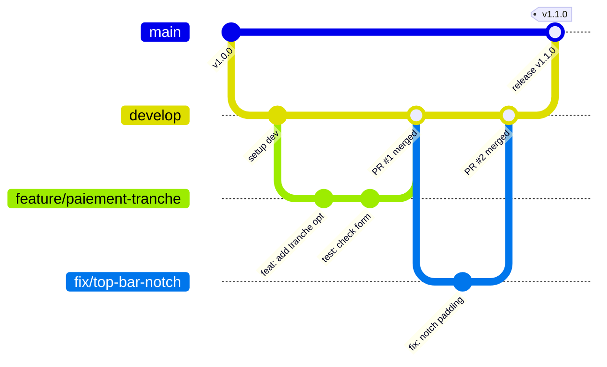

# 🚀 Guide de Contribution & Stratégie Git — SAMA LOYER

Bienvenue sur le projet **SAMA LOYER** (Orange Super-App Maxit / TCMPP).
Ce document formalise nos standards de développement, de gestion des branches et de rédaction des commits pour garantir une collaboration professionnelle, fluide et traçable.

---

## 🌳 1. Stratégie de Branches (Git Flow Pro)

Le dépôt s'articule autour de deux branches pérennes et de branches de travail éphémères :



### Rôles des Branches :

| Branche | Rôle | Règles de déploiement / Accès |
|---|---|---|
| `main` | **Production stable** | Code prêt pour le déploiement Maxit. Protégée contre les push directs : uniquement via Pull Request validée depuis `develop`. |
| `develop` | **Intégration & Staging** | Branche active où confluent toutes les nouvelles fonctionnalités testées. |
| `feature/<nom>` | Nouvelle fonctionnalité | Branche créée à partir de `develop` et mergée dans `develop` via PR. |
| `fix/<nom>` ou `bugfix/<nom>` | Correction de bug standard | Branche créée à partir de `develop` pour résoudre un bug identifié en test/dev. |
| `hotfix/<nom>` | Correction critique en prod | Branche créée à partir de `main` en cas d'urgence, puis mergée dans `main` ET `develop`. |
| `docs/<nom>` | Documentation seule | Mise à jour README, spécifications fonctionnelles, schémas d'architecture. |

---

## 📝 2. Norme de Commit : Conventional Commits v1.0.0

Chaque commit doit respecter le format standardisé suivant :

```text
<type>(<périmètre optionnel>): <description au présent, impératif>

[corps explicatif optionnel détaillant le 'pourquoi']

[référence au ticket/PR optionnelle, ex: Closes #12]
```

### Types Autorisés :

- `feat`: Nouvelle fonctionnalité pour l'utilisateur (ex: `feat(paiement): ajout du paiement par tranche`)
- `fix`: Correction d'un bug (ex: `fix(auth): résolution du délai d'expiration de session`)
- `style`: Retouches CSS/WXSS, ajustement graphique sans impact logique (ex: `style(top-bar): ajustement hauteur pour notch iPhone`)
- `refactor`: Refonte ou optimisation de code sans modification fonctionnelle
- `perf`: Amélioration de performance (mémoire, temps de chargement, setData)
- `docs`: Ajout ou modification de documentation (README, guides)
- `chore`: Maintenance technique, dépendances, configuration CI/CD, outils internes
- `test`: Ajout ou mise à jour de tests unitaires/E2E

### Exemples Concrets :

```bash
# ✅ Bon :
git commit -m "feat(locataires): ajout du bouton de relance SMS en Wolof"
git commit -m "fix(contrat): correction de la date d'échéance dans le récapitulatif"
git commit -m "style(icons): harmonisation de la couleur framboise #C8235F"

# ❌ À éviter :
git commit -m "update"
git commit -m "fix bug"
git commit -m "wip"
```

---

## 🔄 3. Cycle de Vie d'une Tâche (Workflow Quotidien)

1. **Se synchroniser avec `develop` :**
   ```bash
   git checkout develop
   git pull origin develop
   ```

2. **Créer une branche de travail dédiée :**
   ```bash
   git checkout -b feature/nom-de-la-feature
   ```

3. **Développer et commiter régulièrement :**
   ```bash
   git add .
   git commit -m "feat(module): description claire"
   ```

4. **Pousser la branche de travail sur GitHub :**
   ```bash
   git push -u origin feature/nom-de-la-feature
   ```

5. **Ouvrir une Pull Request (PR) vers `develop` :**
   - Remplir le template de PR.
   - Demander une relecture (Code Review).
   - Une fois validée, merger dans `develop`.
