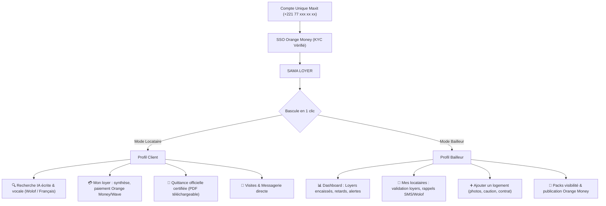
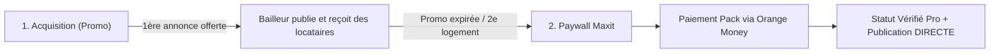

# 🏠 SAMA LOYER — Mini-App Immobilière pour Maxit (Orange Sénégal)

> **Projet Hackathon Orange** — Plateforme immobilière intelligente intégrée dans la Super-App **Maxit**, digitalisant la recherche, la mise en location, la contractualisation et le paiement certifié des loyers au Sénégal.

---

## 📑 Sommaire

1. [Vision & Positionnement dans Maxit](#-1-vision--positionnement-dans-maxit)
2. [Modèle Double Profil (Client & Bailleur)](#-2-modèle-double-profil-client--bailleur)
3. [Modèle Économique, Paywall & Monétisation Orange Money](#-3-modèle-économique-paywall--monétisation-orange-money)
4. [Architecture Technique du Mini-Programme](#-4-architecture-technique-du-mini-programme)
5. [Règles de Navigation WeChat / TCMPP](#-5-règles-de-navigation-wechat--tcmpp)
6. [Design System & Composants Clés](#-6-design-system--composants-clés)
7. [Back-Office d'Administration](#-7-back-office-dadministration)

---

## 🎯 1. Vision & Positionnement dans Maxit

**SAMA LOYER** est conçu pour s'intégrer nativement dans la Super-App **Maxit** (Orange) via la technologie des mini-programmes (TCMPP) :

* **Authentification unique (SSO Maxit)** : L'utilisateur se connecte automatiquement avec son numéro Orange (`+221 77...`).
* **Sécurité & KYC Certifié** : L'identité du compte Orange Money certifie les utilisateurs, éliminant les faux démarcheurs et arnaques de faux logements à Dakar.
* **Paiement In-App direct** : Paiement des loyers et des cautions directement depuis le solde Orange Money du locataire vers le compte Orange Money du bailleur.
* **Conformité Réglementaire** : Intégration du décret de régulation des loyers de mars 2023 de la République du Sénégal (quittances certifiées numérotées, plafonnement légal des cautions à 1 ou 2 mois, préavis de départ de 1 mois).

---

## 👥 2. Modèle Double Profil (Client & Bailleur)

Un même compte Maxit peut porter les **deux casquettes** sans aucune friction ni déconnexion :



* **Comme sur Airbnb ou Uber** : L'utilisateur navigue en tant que locataire par défaut, et peut en 1 clic dans son profil ou sur son avatar choisir *« Basculer en Espace Bailleur »*.
* Les interfaces, barres d'onglets et données s'adaptent instantanément.

---

## 💰 3. Modèle Économique, Paywall & Monétisation Orange Money

### A. La stratégie d'acquisition Freemium ➔ Paywall



1. **Phase 1 : Promo de lancement**  
   * La 1ère annonce (ou les 30 premiers jours) est offerte pour inciter les bailleurs dakarois à référencer leurs biens.
2. **Phase 2 : Paywall quand la promo est dépassée**  
   * Dès que le bailleur veut publier au-delà de son quota d'essai :
   * Un message s'affiche :  
     > *« Votre offre promotionnelle est terminée. Pour continuer à publier et trouver des locataires qualifiés, activez votre Pack Bailleur directement avec votre solde Orange Money. »*

### B. Publication Directe (Bailleur Vérifié) vs Validation Manuelle

| Statut du Bailleur | Processus de Publication | Validation Admin | Délai de mise en ligne |
|---|---|---|---|
| **🟢 Bailleur Vérifié (Pack Orange Money actif)** | **Instantané** (Auto-approbation) | Aucune (contrôle a posteriori si signalement) | **Immédiat (1 seconde)** |
| **🟡 Bailleur Standard (Sans offre / non certifié)** | En attente de validation | Revue manuelle par le Super Admin | 24 h à 48 h |

---

## 🏛️ 4. Architecture Technique du Mini-Programme

Toutes les pages sont organisées de manière symétrique dans des sous-dossiers dédiés sous `pages/` :

```
pages/
├── client/                      # Module Locataire (Client)
│   ├── home/                    # Recherche IA écrite & vocale Wolof/FR, 3 recs dynamiques
│   ├── search/                  # Résultats filtrables, vue carte, chips catégories
│   ├── logement-detail/         # Fiche logement complète, photos, visite, caution
│   ├── loyers/                  # "Mon loyer" : synthèse 125 000 F, quittances, paiement
│   ├── visites/                 # Suivi des visites confirmées, passées, annulées
│   ├── demande-visite/          # Prise de RDV avec sélection de créneaux
│   ├── messages/                # Boîte de réception messagerie
│   ├── chat/                    # Messagerie temps réel & raccourcis WhatsApp
│   ├── favoris/                 # Sauvegarde des logements coup de cœur
│   └── profile/                 # Profil locataire & bascule Espace Bailleur
│
└── bailleur/                    # Module Propriétaire (Bailleur)
    ├── home/                    # Dashboard bailleur : KPIs, alertes, raccourcis
    ├── annonces/                # Gestion des logements loués et disponibles
    ├── ajouter/                 # Formulaire d'ajout de bien en 5 étapes
    ├── demandes/                # Gestion des candidatures de locataires
    ├── locataires/              # "Mes locataires" : barre tricolore, actions directes
    └── premium/                 # Boosts d'annonces & factures professionnelles
```

---

## ⚡ 5. Règles de Navigation WeChat / TCMPP

Pour éviter les erreurs bloquantes du runtime WeChat (`fail can not redirectTo a tabbar page`), le routeur [`components/ui/tab-bar/index.js`](components/ui/tab-bar/index.js) applique un routage strict :

1. **Onglets Clients (`tabBar.list` dans `app.json`)** :
   * `pages/client/home/home` (Chercher)
   * `pages/client/loyers/loyers` (Mon loyer - Badge `2`)
   * `pages/client/visites/visites` (Visites)
   * `pages/client/messages/messages` (Messages - Badge `3`)
   * `pages/client/profile/profile` (Profil)  
   👉 **Obligatoirement appelés via `wx.switchTab({ url })`**.

2. **Onglets Espace Bailleur (Hors `tabBar.list`)** :
   * `pages/bailleur/home/home`, `annonces`, `ajouter`, `locataires`, `demandes`.  
   👉 **Appelés via `wx.redirectTo({ url })`**.

3. **Protection des feuilles modales (*Bottom Sheets*)** :
   * Pour éviter que la barre d'onglets ne recouvre les boutons d'action des modales (*Payer*, *Fermer l'aperçu* sur `Mon loyer`) :
     * `wx.hideTabBar({ animation: true })` à l'ouverture de la modale.
     * `wx.showTabBar({ animation: true })` à la fermeture.
     * `padding-bottom: calc(150rpx + env(safe-area-inset-bottom))` sur `.modal-sheet`.

---

## 🎨 6. Design System & Composants Clés

### Palette de Couleurs Officielles

* **Berry Framboise (`#C8235F`)** : Couleur d'action primaire Orange/Sama, boutons principaux, badges d'alerte.
* **Deep Navy (`#0F1E3D`)** : Titres majeurs, fonds sombres des KPIs de loyers.
* **Mint Green (`#007C3D` / `#E2F0EA`)** : Statuts payés, quittances certifiées conformes.
* **Warning Amber (`#D97706` / `#FEF9C3`)** : Loyers à confirmer, signalements de pannes.
* **Soft Red (`#DC2626` / `#FEE2E2`)** : Retards de paiement de loyer.

### Composant Notification Flottante (« Dynamic Island / Pill »)
Remplace les anciens carrés noirs natifs WeChat par une pilule flottante animée en haut d'écran :
* Dégradé bleu nuit glassmorphism (`backdrop-filter: blur(14px)`).
* Cercle icône Berry ou Cyan selon le contexte.
* Titre net + sous-titre dynamique IA (ex: `Reconnu (Wolof) : Ngor · 50 000 F CFA · 3 trouvés ✨`).

---

## 🖥️ 7. Back-Office d'Administration

Situé dans le dossier [`back_office/`](back_office/) :
* Développé en **React + TypeScript + Vite**.
* Interface responsive (Desktop, Tablette et Mobile avec menu repliable).
* Gestion des signalements locataires / réclamations plomberie et électricité.
* Supervision des bailleurs certifiés et des transactions Orange Money.
* Compilation validée sans erreur via `npm run build` (`tsc -b && vite build`).

---

*Branche active du projet : `sama-logement`*
