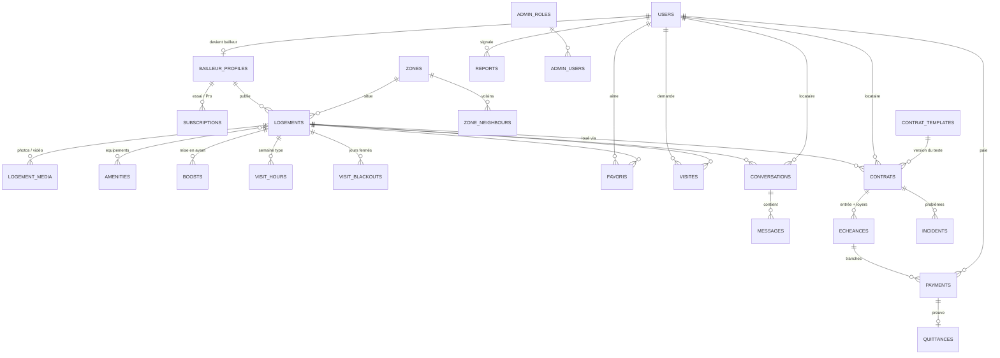

# 01 — Modèle de données SAMA LOYER

> Schéma exécutable : [schema.sql](schema.sql) (PostgreSQL 15+, compatible TencentDB).
> Ce document explique **pourquoi** le modèle est construit ainsi et les **règles métier** que le backend doit faire respecter.

## 1. Vue d'ensemble



Domaines :

| Domaine | Tables | Écrans concernés |
|---|---|---|
| Identité | `users`, `refresh_tokens`, `bailleur_profiles`, `subscriptions` | Profil, accueil bailleur (activation), Premium |
| Catalogue | `zones`, `zone_neighbours`, `amenities`, `logements`, `logement_media`, `logement_amenities`, `boosts`, `favoris` | Accueil, recherche, fiche logement, favoris, Ajouter, Mes annonces |
| Visites | `visit_hours`, `visit_blackouts`, `visites` | Demande de visite, Mes visites, Horaires, Demandes |
| Messagerie | `conversations`, `messages` | Messages, chat (locataire et bailleur) |
| Location | `contrat_templates`, `contrats`, `echeances`, `payments`, `quittances` | Entrée, Louer sans visite, Contrat, Mon loyer, Locataires |
| Confiance | `incidents`, `reports` | « Signaler un problème », réclamations back office |
| Back office | `admin_roles`, `admin_users`, `support_tickets`, `app_settings`, `audit_logs`, `notifications_outbox` | Toute l'appli `back_office/` |

## 2. Choix structurants

1. **Un seul compte utilisateur, deux casquettes.** L'identité vient de Max it (`maxit_user_id`, `phone`). Devenir bailleur crée une ligne `bailleur_profiles` ; aucun second compte, aucun formulaire (comme dans `activateBailleurAccount`).
2. **Montants en entiers XOF (`BIGINT`).** Le franc CFA n'a pas de centimes : pas de `float`, pas de `numeric(…,2)`. Le formatage `80 000 F` reste côté front.
3. **Échéance ≠ paiement ≠ quittance.**
   - *Échéance* : ce qui est dû (l'entrée, ou le loyer de novembre).
   - *Paiement* : un mouvement d'argent. Une échéance peut recevoir plusieurs paiements (**tranches**).
   - *Quittance* : la preuve émise pour chaque paiement réussi.
   C'est ce qui rend possible « payer l'entrée par tranche, au moins l'avance tout de suite ».
4. **Le contrat signé est figé.** `articles_snapshot` contient le texte rendu avec les vrais montants et `content_hash` son empreinte SHA-256. Changer `contrat_templates` n'altère jamais un bail signé.
5. **Créneaux de visite calculés, pas stockés.** Le bailleur saisit une semaine type (`visit_hours`) et des jours fermés (`visit_blackouts`). L'API calcule les 16 prochains jours en retirant les créneaux déjà acceptés.
6. **Adresse précise protégée.** `address_detail` n'est renvoyée qu'au locataire dont la visite est acceptée ou qui a un contrat sur le logement. Avant, seul `place_label` (« Ouakam, Cité Avion ») est public.
7. **Rien n'est supprimé physiquement** dans les paiements, contrats, quittances et journaux. Les annonces ont `deleted_at`.
8. **Paramètres pilotés par le back office** dans `app_settings` (tarifs, délais, fonctionnalités), lus par l'API, jamais codés en dur.

## 3. Cycles de vie (machines à états)

### Logement

```
draft ──▶ validation ──(admin approuve)──▶ online ──(1er paiement d'entrée)──▶ reserved ──(entrée soldée)──▶ rented
              │                              │  ▲                                                          │
              └─(admin refuse)─▶ rejected    │  └──(bailleur confirme dispo)─┐                             │
                                             └──(non confirmé 21 j / admin)─▶ hidden ◀────────────────────┘ (fin de bail → online)
```

- `online` → `hidden` automatiquement si `availability_confirmed_at` date de plus de `rules.autoHideAfterDays` (21 j). Rappel au bout de 7 j.
- Une modification du prix, des photos ou de la description d'une annonce `online` la repasse en `validation`.
- Seules les annonces `online` (et `reserved`, marquées « Réservé ») sont visibles dans la recherche.

### Visite

```
pending ──(bailleur accepte)──▶ accepted ──(date passée)──▶ done
   │  └──(bailleur refuse)──▶ rejected        └──(signalé absent)──▶ no_show
   └──(locataire annule)──▶ cancelled  ◀──(locataire annule)── accepted
```

- Une demande `pending` sans réponse 48 h avant le créneau passe en `rejected` avec `response_note = "Pas de réponse du bailleur"`.
- Accepter révèle `address_detail` au locataire, envoie un SMS (outbox) et ajoute un message `event` dans la conversation.

### Contrat

```
pending_signature ──(locataire signe + 1er paiement d'entrée réussi)──▶ active ──(préavis)──▶ notice ──(departure_date)──▶ terminated
        │
        └──(paiement non fait sous 24 h / annulation)──▶ cancelled
```

- Le bailleur signe **par avance** en publiant l'annonce (acceptation des conditions générales SAMA LOYER) : `bailleur_signed_at` = date de création du contrat. Le locataire signe dans l'écran Entrée (étape 2).
- `keys_handed_over_at` est renseigné quand l'échéance d'entrée est `paid`.
- Fin de bail : la caution passe `held` → `refunded` / `partially_refunded` dans les 30 jours après l'état des lieux.

### Échéance

`pending` → `partial` (au moins une tranche) → `paid`. Passe à `late` le lendemain de `due_date` si non soldée (job quotidien). `cancelled` si le contrat est annulé.

### Paiement

`pending` → `succeeded` | `failed` | `expired` (15 min sans retour Max it). `succeeded` → `refunded` (par un paiement `purpose = refund`).

## 4. Règles métier (le backend les vérifie, jamais le front seul)

### Entrée dans un logement
| Règle | Valeur |
|---|---|
| Total de l'entrée | `advance_amount + deposit_amount + fees_amount` |
| Premier paiement minimum | `advance_amount` (l'avance) |
| Tranche suivante | entre 1 F et le reste dû (`badAmount` du front) |
| Logement bloqué pour le locataire | dès le 1er paiement réussi (`reserved`) |
| Clés remises | quand l'échéance d'entrée est soldée |
| Date limite du solde | veille de `start_date` |
| Loué sans visite | `issue_window_ends_at = start_date + 48 h` pour signaler un problème |

### Loyer
- Échéance mensuelle générée le 1er de chaque mois pour chaque contrat `active`/`notice`, `due_date` = `due_day` (5 par défaut).
- Rappel à J-3, le jour J, puis J+1 (statut `late`).
- Paiement partiel autorisé (tranches) ; quittance finale quand l'échéance est soldée, reçu de tranche sinon (`is_final = false`).
- Paiement **en espèces** : seul le bailleur peut le déclarer (`method = cash`, `confirmed_by` = bailleur). Une quittance est émise.

### Contrat
- Durée minimum 6 mois, défaut 12 mois, renouvellement automatique.
- Préavis 1 mois, donné dans l'appli par l'une des parties : `departure_date ≥ notice_given_at + notice_months`.
- Numérotation : `SL-{AAAA}-{MM}-{séquence sur 4 chiffres}`.

### Bailleur
- Accès à l'espace bailleur **uniquement** avec une souscription en cours (`ends_at > now()`), sinon `403 SUBSCRIPTION_REQUIRED`.
- Essai gratuit de 30 jours, **une seule fois** (index unique partiel).
- Renouvellement Pro : `ends_at = max(now, ends_at actuel) + 30 j`.
- Boost : abonnement actif requis, sur une annonce `online`. Une annonce boostée remonte en tête de son quartier.
- Badge « Bailleur vérifié » = `verification_status = active`.
- `reports_count ≥ rules.reportsBeforeSuspension` (3) ⇒ suspension automatique et masquage des annonces.

### Anti-fraude à la publication (drapeaux pour le modérateur)
- Numéro de téléphone ou lien détecté dans la description.
- Prix < 50 % de la médiane du quartier pour le même type.
- Moins de 4 photos, ou photo déjà présente sur une autre annonce (hash perceptuel).
- Mots-clés « transfert », « avant visite », « réserver par Wave/OM ».

### Sécurité des données
- Le numéro du bailleur est masqué (`+221 77 ••• •• 30`) tant qu'il n'y a ni visite acceptée ni contrat.
- Pièces d'identité et PDF de contrats dans un bucket COS **privé**, servis par URL signée (15 min).

## 5. Index et volumétrie

Les index ciblent les écrans les plus fréquents :
- Recherche : `(status, zone_id, rent_amount)` + trigramme sur `title`.
- Listes personnelles triées par date : visites, conversations, paiements, quittances.
- Index uniques partiels qui portent des règles métier : un seul essai, une seule demande de visite ouverte par logement et par locataire, un seul créneau accepté, un seul contrat vivant par logement, une seule échéance par mois.

## 6. Tâches planifiées

| Tâche | Fréquence | Effet |
|---|---|---|
| Génération des loyers | 1er du mois, 00:05 | crée les `echeances` `rent` du mois |
| Retards | chaque jour, 00:10 | `pending`/`partial` dont `due_date` < aujourd'hui → `late` |
| Rappels de loyer | chaque jour, 09:00 | SMS J-3, J, J+1 |
| Paiements expirés | toutes les 5 min | `pending` dont `expires_at` < now → `expired` |
| Disponibilité des annonces | chaque jour | rappel à 7 j, masquage à 21 j |
| Visites passées | toutes les heures | `accepted` dont le créneau est passé → `done` |
| Abonnements | chaque jour | `active` dont `ends_at` < now → `expired` |
| Outbox | en continu | envoi SMS / notifications Max it |
